<h1 align="center">🛒 SaleFlow</h1> <h3 align="center">Hệ thống trợ lý AI tư vấn, hỗ trợ bán hàng & tự động hóa đơn hàng</h3>

<p align="center">
  Bot Telegram tư vấn và bán sản phẩm số, kết hợp <b>RAG</b>, <b>n8n</b> và thanh toán <b>SePay (VietQR)</b>.<br>
  Xử lý trọn quy trình: tư vấn → tạo đơn → thanh toán → đối soát → giao sản phẩm.
</p>

<p align="center">
  
  
  
  
  
  
  
</p>

<p align="center">
  <a href="#-giới-thiệu">Giới thiệu</a> •
  <a href="#-kiến-trúc">Kiến trúc</a> •
  <a href="#-cài-đặt--sử-dụng">Cài đặt</a> •
  <a href="#-demo">Demo</a> •
  <a href="#-đánh-giá">Đánh giá</a> •
  <a href="#-giới-hạn--hướng-phát-triển">Hướng phát triển</a>
</p>

---

## 📖 Giới Thiệu

Bán hàng online thường gặp hai vấn đề: chatbot thuần LLM có thể tự bịa giá hoặc nội dung sản phẩm, và các khâu tạo đơn, kiểm tra sao kê, giao hàng bị làm tay rời rạc nên hay xảy ra tình trạng tiền đã về nhưng đơn chưa được cập nhật.

Dự án tách hệ thống thành hai lớp:

| Lớp | Công nghệ | Phụ trách |
| :--- | :---: | :--- |
| **Tư vấn** | RAG | Truy xuất từ tài liệu của shop, giữ ngữ cảnh hội thoại, nhận biết khi khách muốn mua |
| **Nghiệp vụ** | n8n | Tạo đơn, sinh QR, nhận webhook thanh toán, đối soát, giao sản phẩm |

> AI chỉ trò chuyện và gợi ý. Mã sản phẩm, giá, trạng thái đơn và trạng thái thanh toán do dữ liệu nghiệp vụ và workflow quyết định.

### 🧭 Hành trình của khách hàng

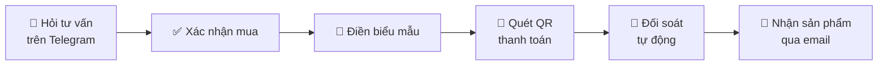

- Khi khách nói muốn mua, bot chưa tạo đơn ngay mà hiện mã sản phẩm để khách **xác nhận**, tránh hiểu sai ý định hoặc chọn nhầm sản phẩm.
- Đơn được tạo ở trạng thái `PENDING`. Khi SePay gửi webhook, hệ thống đối chiếu **mã đơn và số tiền**: khớp thì chuyển sang `PAID` và giao sản phẩm, không khớp thì giữ lại để kiểm tra.

---

## 🏗️ Kiến Trúc

Ba luồng n8n dùng chung dữ liệu nghiệp vụ; RAG chạy như một API riêng để n8n gọi.

| Luồng | Nhiệm vụ |
| :--- | :--- |
| **Workflow 00**<br/>Telegram RAG Assistant | Nhận tin nhắn, gọi RAG API, trả lời khách. Khi `intent = "buy"`, gửi nút xác nhận mua kèm liên kết biểu mẫu |
| **Workflow 01**<br/>Create Order & Payment QR | Nhận biểu mẫu, lấy giá từ bảng `PRODUCT`, tạo đơn `PENDING`, sinh VietQR gửi cho khách |
| **Workflow 02**<br/>SePay Webhook & Reconciliation | Nhận webhook, đối soát, cập nhật `PAID`, gửi sản phẩm qua email, báo lại trên Telegram |

### 🔍 Pipeline RAG

**Indexing** (offline, chạy khi tài liệu thay đổi):

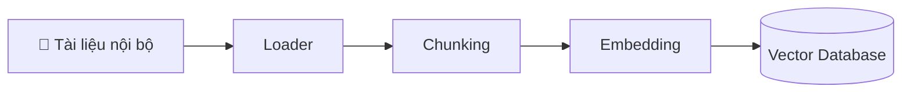

**Generation** (online, chạy mỗi khi khách nhắn tin):

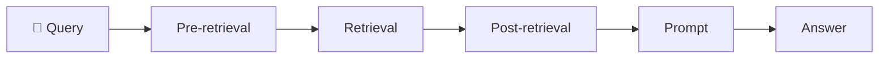

---

## 🧰 Công Nghệ Sử Dụng

| Thành phần | Công nghệ | Vai trò |
| :--- | :--- | :--- |
| **LLM** | `OpenAI GPT-4.1-mini` | Trả lời tư vấn, nhận diện ý định mua và mã sản phẩm (JSON Schema) |
| **Embedding Model** | `text-embedding-3-small` | Chuyển văn bản thành vector |
| **Document Loader** | `Docling` | Đọc PDF, giữ nguyên bảng và heading dưới dạng Markdown |
| **Vector Database** | `ChromaDB` | Lưu vector, tìm kiếm theo ngữ nghĩa (Dense) |
| **Sparse Retrieval** | `Rank-BM25` | Khớp chính xác mã sản phẩm, con số (Sparse) |
| **Reranker** | `BAAI/bge-reranker-v2-m3` | Cross-encoder sắp xếp lại các đoạn truy xuất |
| **Backend API** | `FastAPI`, `Uvicorn` | REST API cho n8n gọi, hỗ trợ streaming |
| **Evaluation** | `Ragas` | Đo chất lượng câu trả lời và truy xuất |
| **Workflow Automation** | `n8n` | Điều phối toàn bộ các workflow |
| **Payment** | `SePay` (VietQR) | Sinh mã VietQR, báo giao dịch qua webhook |
| **Business Database** | `Google Sheets` | Lưu `PRODUCT`, `CUSTOMER`, `ORDER`, `PAYMENT`, `PRODUCT_FILE` |

> Dữ liệu RAG là 12 file PDF mô phỏng (chính sách, danh mục và tài liệu từng sản phẩm). `product_id` là mã chung giữa dữ liệu RAG và Google Sheets.

---

## ⚙️ Cài Đặt & Sử Dụng

**Bước 1: Cài đặt môi trường** (Python 3.10+)

```bash
python -m venv .venv
.venv\Scripts\activate        # Windows
source .venv/bin/activate     # Linux / macOS
pip install -r requirements.txt
```

**Bước 2: Cấu hình API key**

```bash
cp .env.example .env
```

```ini
OPENAI_API_KEY=sk-proj-xxxxxxxxxxxxxxxxxxxxxxxxxxxxxxxx
```

**Bước 3: Lập chỉ mục tài liệu** (chạy lần đầu, hoặc khi đổi tài liệu trong `data/`)

```bash
python main.py index
```

**Bước 4: Chạy RAG API**

```bash
python main.py api
```

API chạy tại `http://localhost:8000`, Swagger UI tại `http://localhost:8000/docs`. Có thể hỏi thử trước khi nối với n8n bằng `python main.py query "..."` hoặc `python main.py chat`.

**Bước 5: Cài đặt n8n**

1. Chạy n8n (tự host), import các file trong `n8n_workflows/`.
2. Tạo credential cho Telegram Bot, Google Sheets, SePay và dịch vụ gửi email.
3. Trỏ node gọi RAG tới địa chỉ API ở bước 4.
4. Cấu hình webhook SePay trỏ về endpoint của Workflow 02, tiền tố mã thanh toán trùng với mã đơn (ví dụ `DH`).

**Bước 6: Chạy thử**

Bật các workflow, nhắn `/start` cho bot và thử đặt một đơn từ tư vấn đến thanh toán.

> Nên dùng một tài khoản ngân hàng riêng cho shop, vì SePay tính hạn mức trên mọi giao dịch tiền vào.

---

## 🎬 Demo

### Tư vấn sản phẩm

Phản hồi khoảng 5 - 10 giây.

<p align="center">
  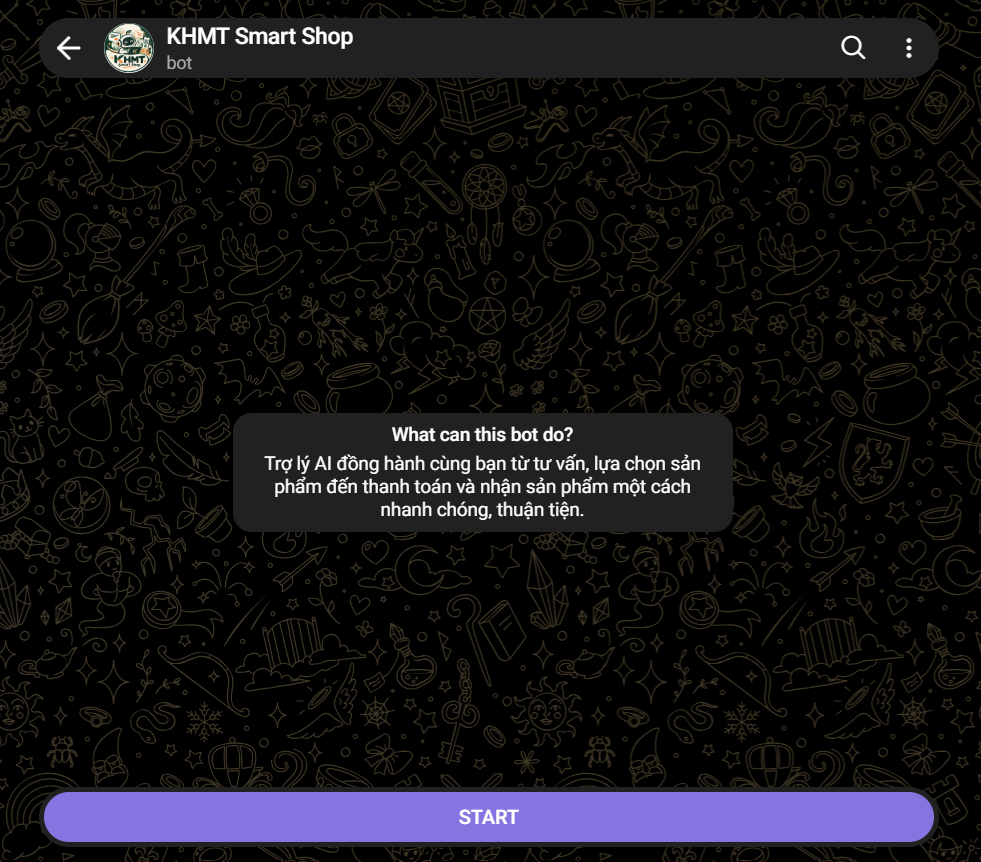
  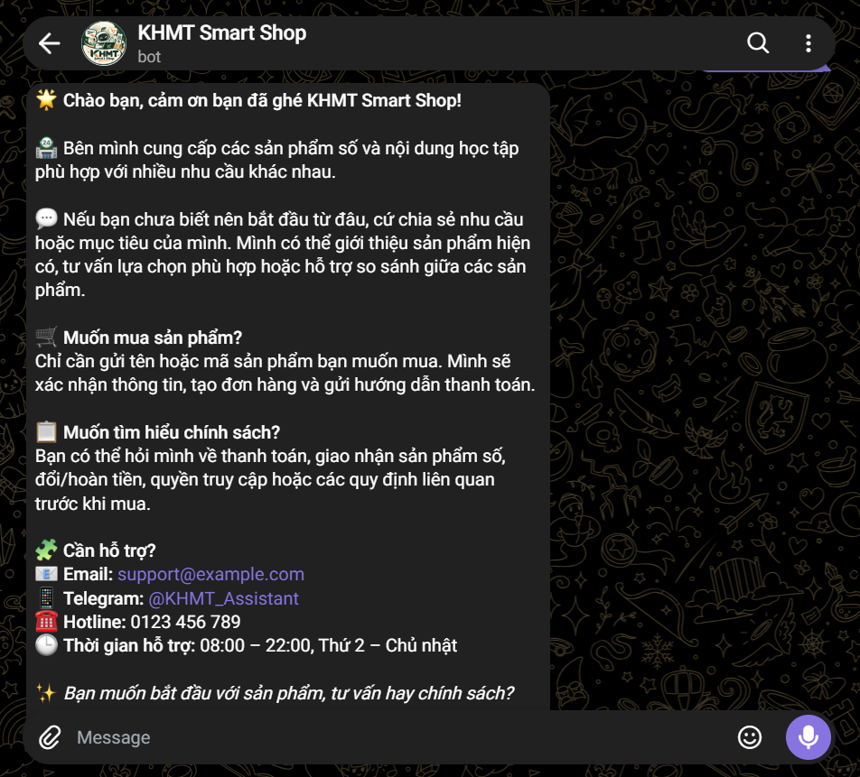
</p>

<p align="center">
  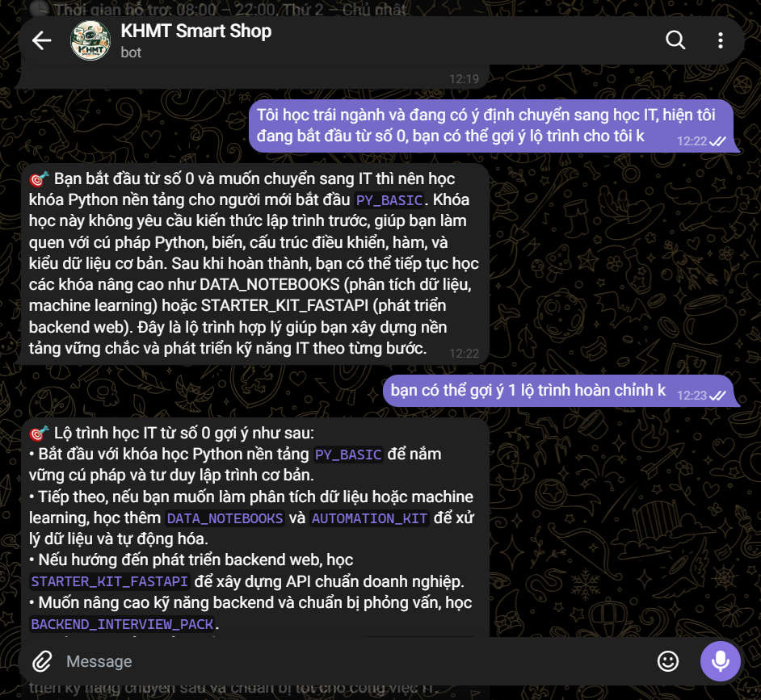
  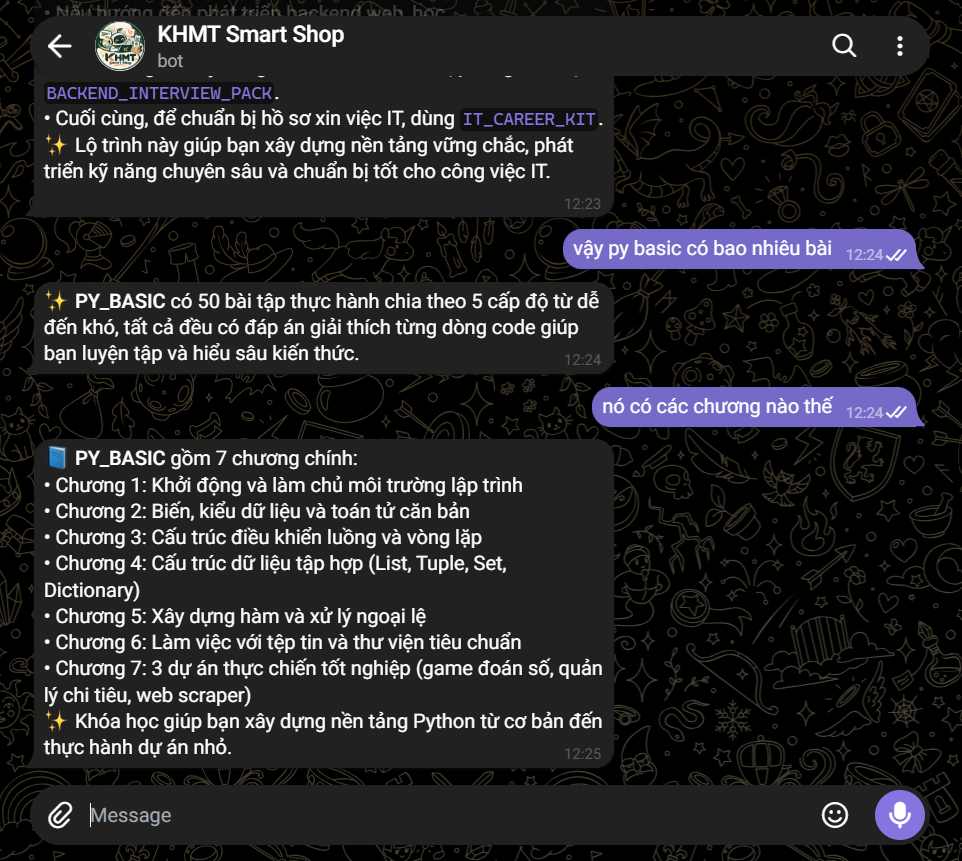
</p>

---

### Xác nhận mua & điền thông tin

<p align="center">
  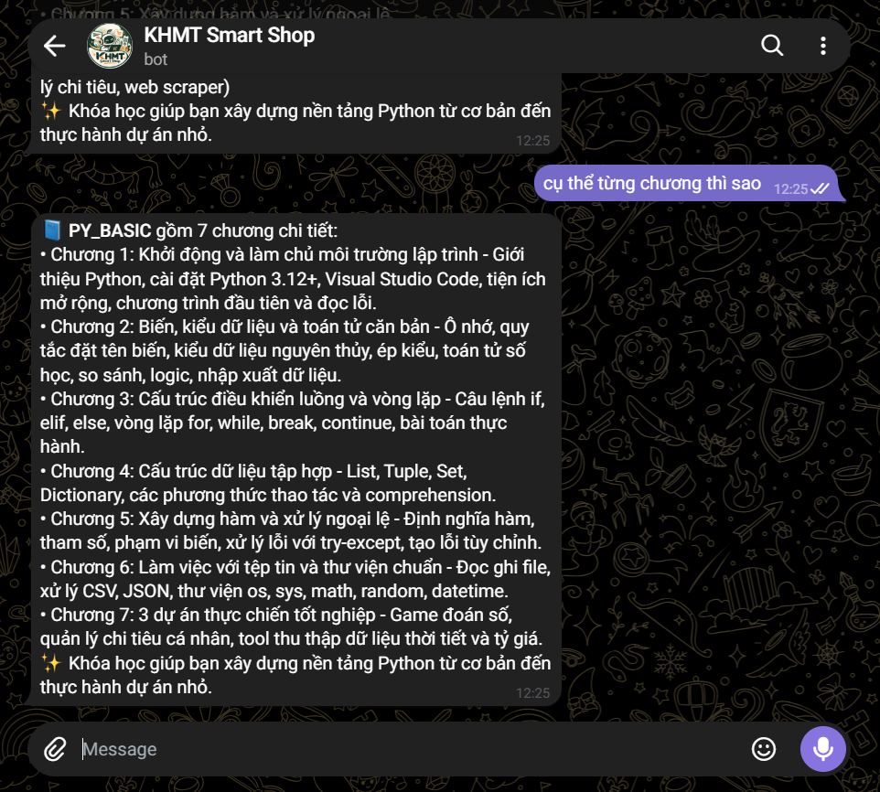
  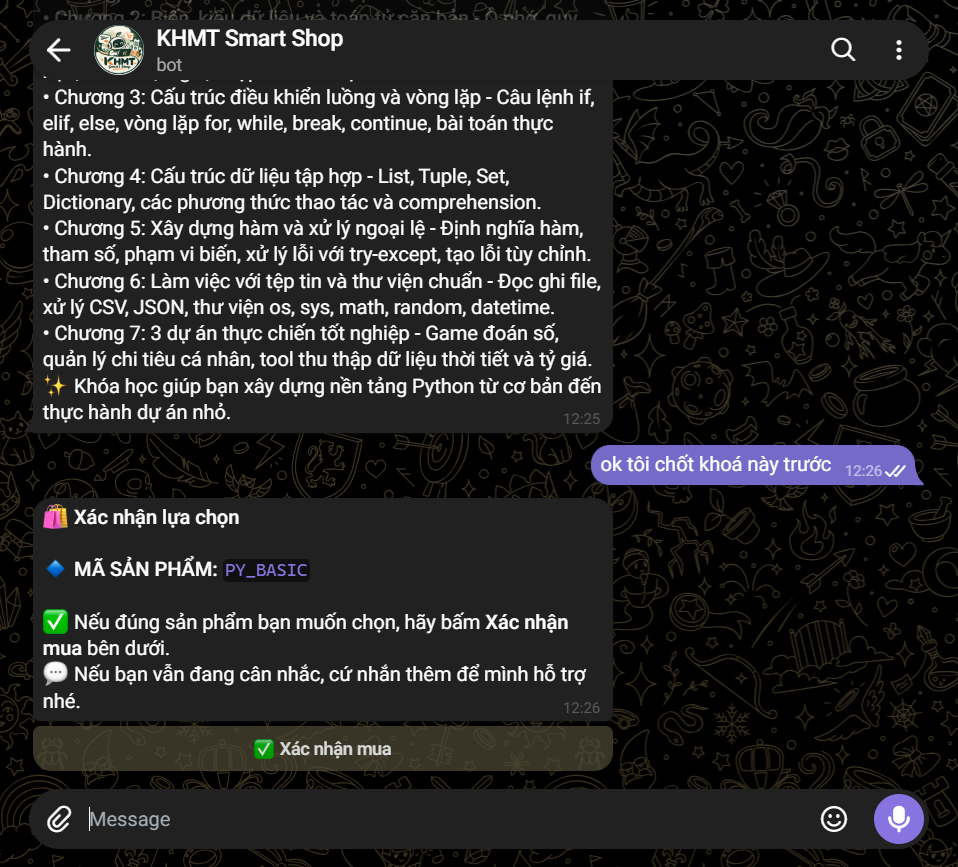
  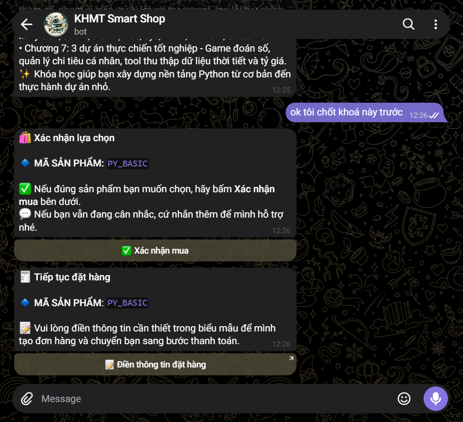
</p>

---

### Thanh toán & giao sản phẩm

Nhận QR sau khoảng 10 giây; đối soát và giao hàng khoảng 15 - 20 giây.

<p align="center">
  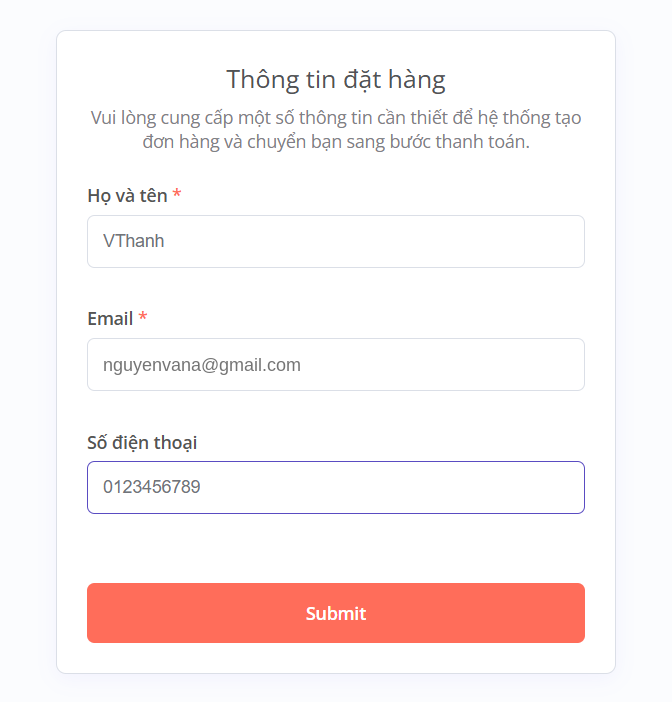
  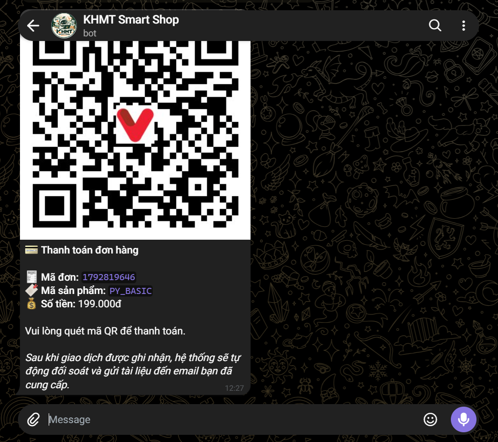
</p>

<p align="center">
  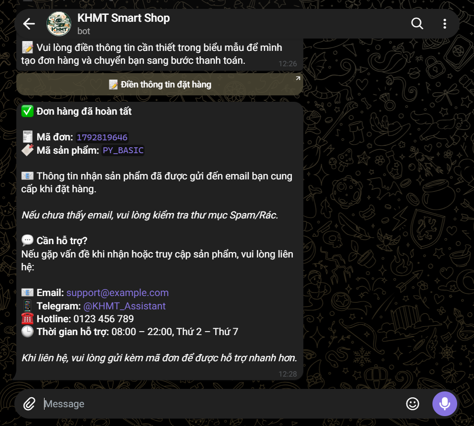
</p>

---

### Workflow trên n8n

<p align="center">
  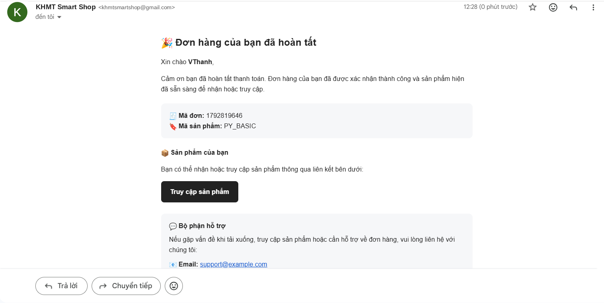
</p>

---

## 📊 Đánh Giá

Đánh giá bằng Ragas, kèm chạy thử và đối chiếu thủ công với tài liệu gốc:

| Chỉ số | Kết quả |
| :--- | :---: |
| **Faithfulness** | 88,81% |
| **Answer Relevancy** | 51,99% |
| **Context Precision** | 77,52% |
| **Context Recall** | 90,00% |

Câu trả lời bám tài liệu tốt, nhưng Answer Relevancy còn thấp dù khi đối chiếu thủ công nhiều câu vẫn đúng trọng tâm. Hai điểm cần cải thiện là **Context Precision** và **Answer Relevancy**.

---

## 🚧 Giới Hạn & Hướng Phát Triển

<table>
<tr>
<td width="50%" valign="top">

**Giới hạn hiện tại**

- Chưa kiểm thử tải.
- Google Sheets chỉ phù hợp giai đoạn demo.
- Chỉ hỗ trợ Telegram, chỉ xử lý văn bản.
- Dữ liệu RAG là dữ liệu mô phỏng.
- Hoàn tiền, lỗi giao hàng, tranh chấp xử lý thủ công.

</td>
<td width="50%" valign="top">

**Hướng phát triển**

- Chuyển sang cơ sở dữ liệu chuyên dụng.
- Thêm kênh tương tác, phương thức thanh toán.
- Tối ưu Retrieval, Session Memory, Cache.
- Bổ sung Monitoring, Backup, bảo mật API.

</td>
</tr>
</table>

---

<p align="center"><i>Nếu thấy dự án hữu ích, hãy để lại một ⭐ cho repo. Góp ý hoặc báo lỗi xin gửi qua Issues.</i></p>